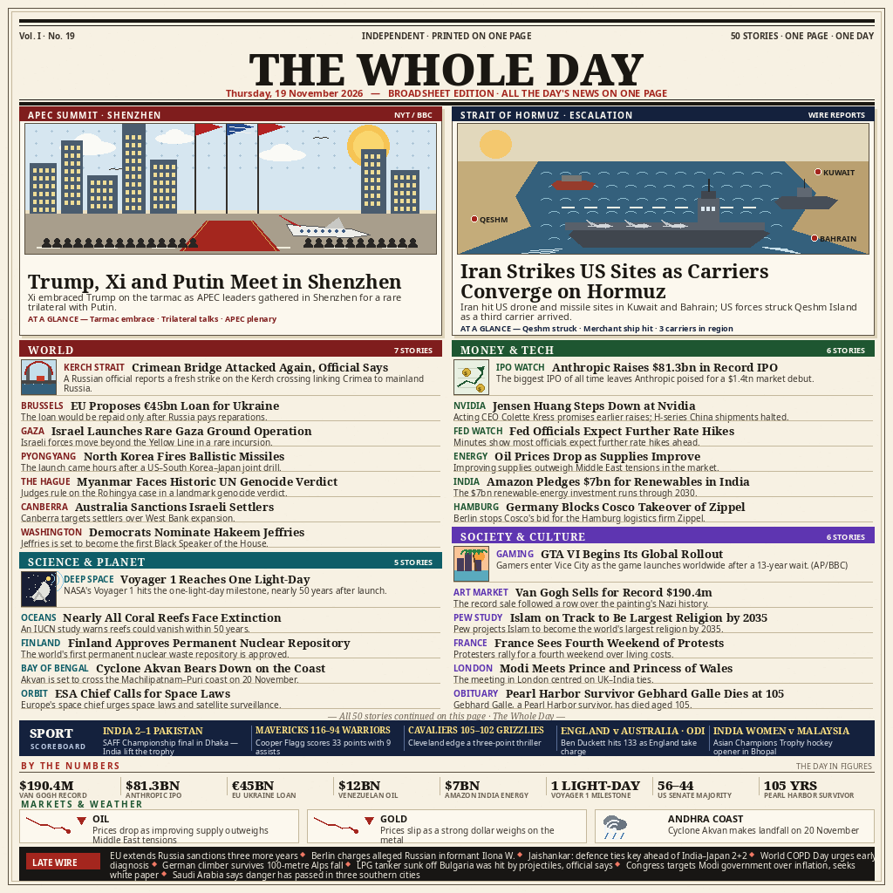

# The Whole Day — Broadsheet Edition

**50 stories · one page · one day.** A single 1024×1024 broadsheet front
page summing up the world news of **Thursday, 19 November 2026**: two big
hero stories with drawn illustrations (the APEC trilateral in Shenzhen and
the Hormuz escalation), four colour-coded sections — World, Money & Tech,
Science & Planet, Society & Culture — a Sport scoreboard strip, a
By the Numbers band, Markets & Weather, and a Late Wire ticker.

[](https://make.fun/c/news-image-20261119)
[](https://make.fun/c/news-image-20261119)
[](https://make.fun/c/news-image-20261119)



## Story count

**50 story items**: 2 heroes + 24 section cards + 5 sport + 8 by-the-numbers
+ 3 markets/weather + 8 late-wire one-liners. The renderer counts the items
from its own data structures and prints the count on every run.

## How to run

```sh
node main.ts        # renders fresh via gazette.py, validates, copies to $MAKEFUN_OUTPUT_DIR (default /output)
python3 gazette.py  # renders entry.png directly (deterministic: same bytes every run)
```

- `gazette.py` — deterministic Python/PIL renderer (fixed seed, no clock,
  no network). Two runs produce a byte-identical `entry.png`.
- `main.ts` — Node 22 entrypoint: runs the renderer, validates the PNG
  (1024×1024, PNG magic, ≤ 1 MiB), copies it to the output directory, and
  falls back to the committed `entry.png` if python3/PIL is unavailable.
- `entry.png` — the committed render. `screenshot.png` — a copy for this README.

Fonts: Noto Serif (Black/Bold/Regular/Italic) for headlines, Noto Sans
(Bold/Regular/SemiBold) for decks and labels.
